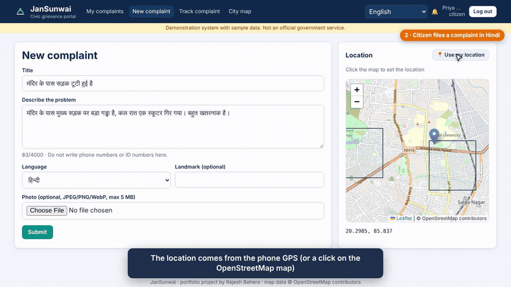
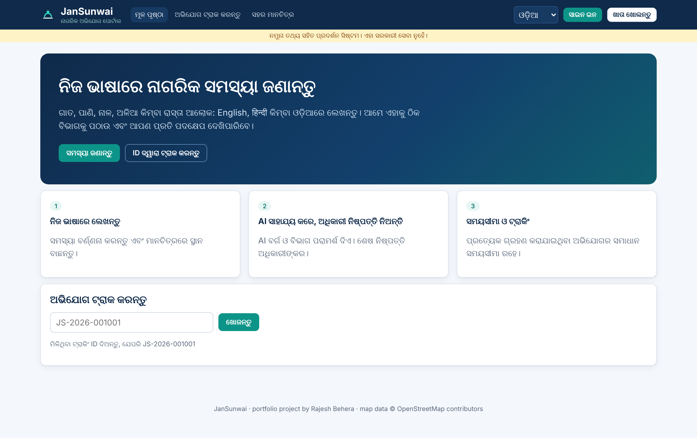
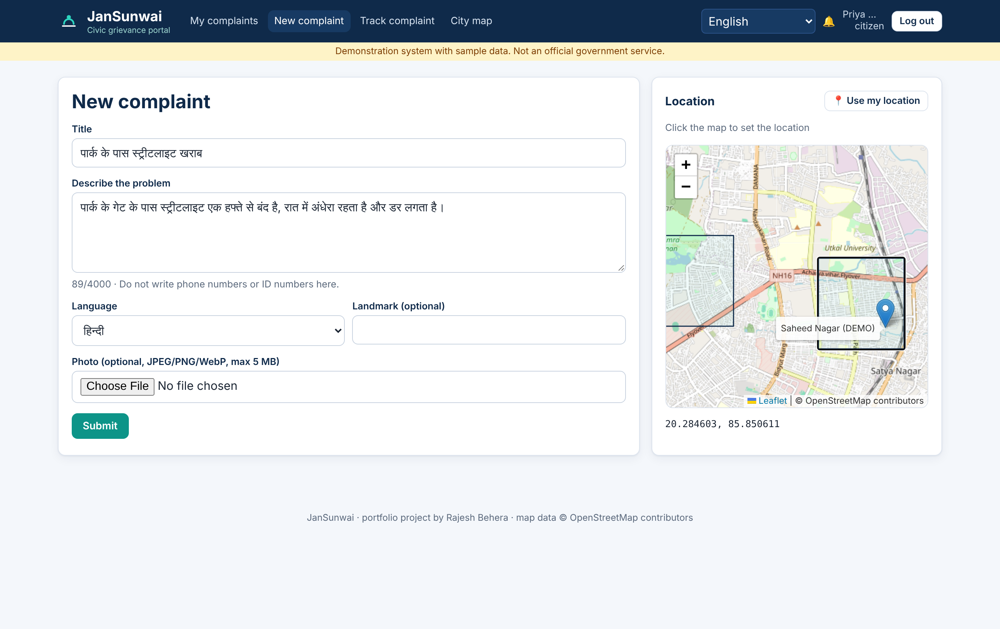
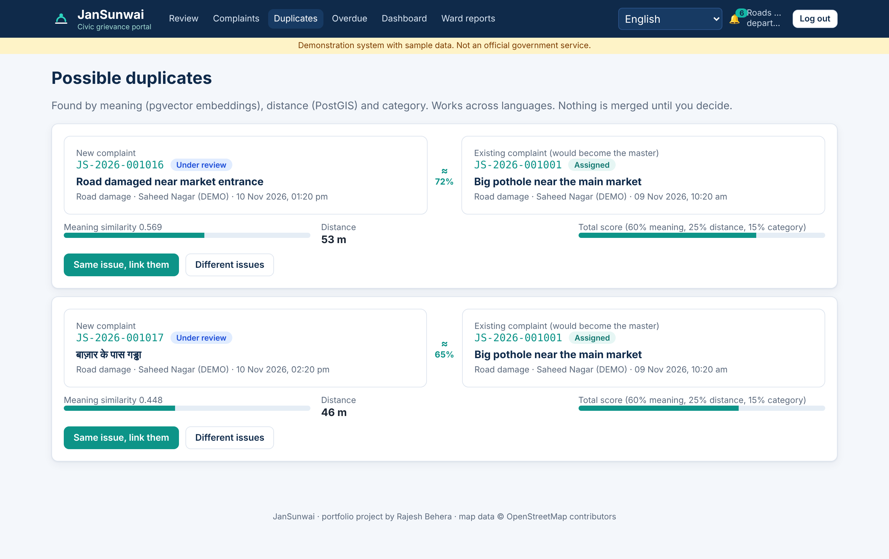
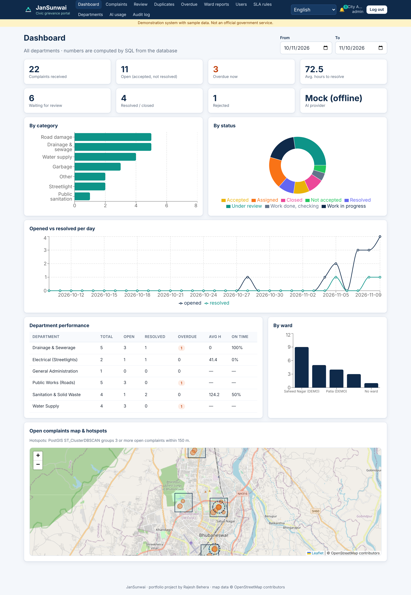
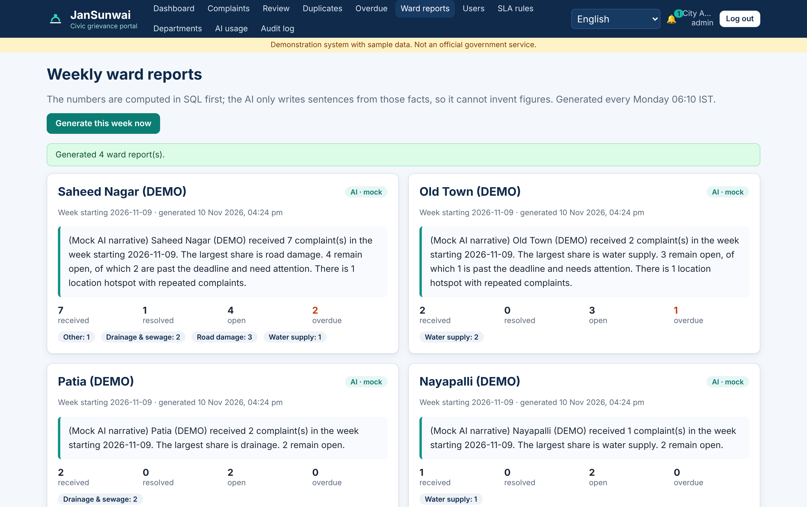
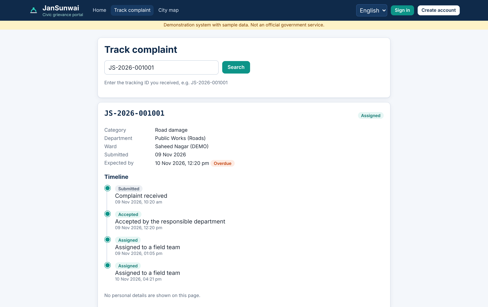

# JanSunwai — AI-powered multilingual civic grievance system

      

> Portfolio project by **Rajesh Behera**. Runs on **demonstration data** (sample wards, users and complaints).
> Not an official government service.

Citizens report civic problems (potholes, water supply, drainage, garbage, streetlights) in **English, हिन्दी or ଓଡ଼ିଆ**,
pin them on a map and track every step. AI **suggests** the category, department and priority, writes an English summary
and finds **duplicate complaints across languages**. Officers always make the final decision. Every accepted complaint
gets a deadline (SLA), and overdue ones are **escalated automatically and exactly once**.

## Demo



▶️ **Full walkthrough video** (about 4.5 minutes, every role, with captions): [docs/demo/jansunwai-demo.mp4](docs/demo/jansunwai-demo.mp4)

## Highlights

| Area | What it does | How |
|---|---|---|
| Multilingual intake | en / hi / or complaints and UI | Script-based language detection, AI translation, i18n dictionary |
| AI classification | Category, department, priority, summary, suggested action | Spring AI (Gemini / Ollama / OpenAI) behind an `AiProvider` interface; **offline mock is the default** |
| AI safety | AI output is untrusted | Timeout + retries (`AiGateway`), strict validation (`AiOutputValidator`), PII redaction, confidence threshold, human review always |
| Semantic duplicates | "बाज़ार के पास गड्ढा" ≈ "Big pothole near the main market" | pgvector embeddings (HNSW, cosine) + PostGIS distance + category → score; **officer approves the link** |
| Geography | Ward detection, nearby check, heatmap, hotspots | PostGIS `ST_Contains`, `ST_DWithin`, `ST_ClusterDBSCAN`, Leaflet + OpenStreetMap |
| Workflow | 11-state machine with role rules | `ComplaintStatus.allowedNext()` + `WorkflowService`; DB CHECK constraints |
| SLA & escalation | Warning at 75 %, L1 at deadline, L2 after 24 h, auto-close | Scheduler; `INSERT … ON CONFLICT DO NOTHING` → idempotent even on several servers |
| Concurrency | Two officers assign at once → one wins | `@Version` optimistic locking + partial unique index |
| Ward reports | Weekly narrative per ward | SQL computes the facts, AI only writes sentences from them (template fallback) |
| Security | JWT, roles, rate limits, privacy | Spring Security, token revocation, magic-byte upload check, public page without personal data |

## Tech stack

**Backend:** Java 21 · Spring Boot 3.5 · Spring Security (JWT) · Spring Data JPA · JdbcTemplate · Spring AI 1.1 · Flyway ·
PostgreSQL 16 + PostGIS + pgvector · springdoc OpenAPI
**Frontend:** React 18 · Vite · React Router · Axios · Recharts · Leaflet / OpenStreetMap
**Quality & ops:** JUnit 5 · Mockito · Testcontainers · JaCoCo · Docker Compose · Nginx · GitHub Actions

## Test results (measured, not estimated)

`mvn verify` on the final code:

| Suite | Tests | Result |
|---|---|---|
| Unit tests (state machine, scorer, validator, mock AI, gateway timeouts/retries, PII, JWT) | 60 | all pass |
| Integration tests (real HTTP + real PostgreSQL/PostGIS/pgvector via Testcontainers) | 40 | all pass |
| **Total** | **100** | **0 failures** |

JaCoCo (unit + integration): **74.5 % lines, 57.5 % branches**. Details and the list of edge cases: [docs/TESTING.md](docs/TESTING.md).

## Run it

### Option 1 — Docker (everything, one command)

```bash
docker compose up --build
```

| URL | What |
|---|---|
| http://localhost:3000 | Web app |
| http://localhost:8080/swagger-ui.html | API documentation |

Demo accounts (password `Demo@1234`): `citizen1@jansunwai.demo`, `roads.officer@jansunwai.demo`,
`roads.field@jansunwai.demo`, `drainage.officer@jansunwai.demo`, `admin@jansunwai.demo` (full list in [docs/DEPLOYMENT.md](docs/DEPLOYMENT.md)).

### Option 2 — local development

```bash
docker build -t jansunwai-postgres:16 docker/postgres
docker run -d --name js-db -p 5432:5432 -e POSTGRES_DB=jansunwai -e POSTGRES_USER=jansunwai \
  -e POSTGRES_PASSWORD=change-me jansunwai-postgres:16

cd backend && SPRING_PROFILES_ACTIVE=dev mvn spring-boot:run      # http://localhost:8080
cd frontend && npm install && npm run dev                          # http://localhost:5173
```

### Use a real AI model (optional)

The default **mock** provider needs no key and costs nothing. To use Google Gemini (free tier) or a local Ollama model,
copy `.env.example` to `.env` and uncomment one block. See [docs/AI_DESIGN.md](docs/AI_DESIGN.md).

## Documentation

| Document | Contents |
|---|---|
| [ARCHITECTURE.md](docs/ARCHITECTURE.md) | Blueprint, components, request flows, ER diagram, design decisions |
| [API.md](docs/API.md) | All endpoints with roles; Postman collection in `postman/` |
| [AI_DESIGN.md](docs/AI_DESIGN.md) | Provider abstraction, prompts, validation, duplicates, costs, Gemini/Ollama setup |
| [TESTING.md](docs/TESTING.md) | Test strategy, edge cases covered, how to run, real results |
| [DEPLOYMENT.md](docs/DEPLOYMENT.md) | Docker, environment variables, production checklist |
| [INTERVIEW_PREP.md](docs/INTERVIEW_PREP.md) | How to explain the project, likely questions and answers |

## Screenshots

| | |
|---|---|
|  |  |
|  |  |
|  |  |

## Honest limitations

- Ward boundaries are demo rectangles; real ones would come from the municipality as GeoJSON.
- Notifications are in-app only (no real SMS/e-mail sending).
- The mock AI uses keyword dictionaries and a hashing embedding: good for demos and tests, not for real accuracy.
  With the mock, duplicate threshold is 0.40; real embedding models need about 0.75 (configurable).
- One backend instance is assumed for the in-memory rate limiter (use Redis/Bucket4j for several instances).
