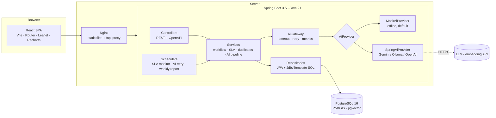
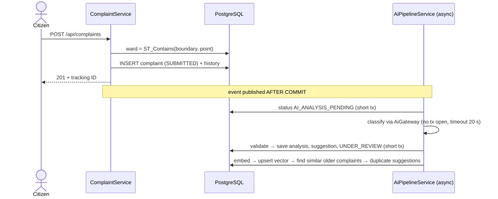
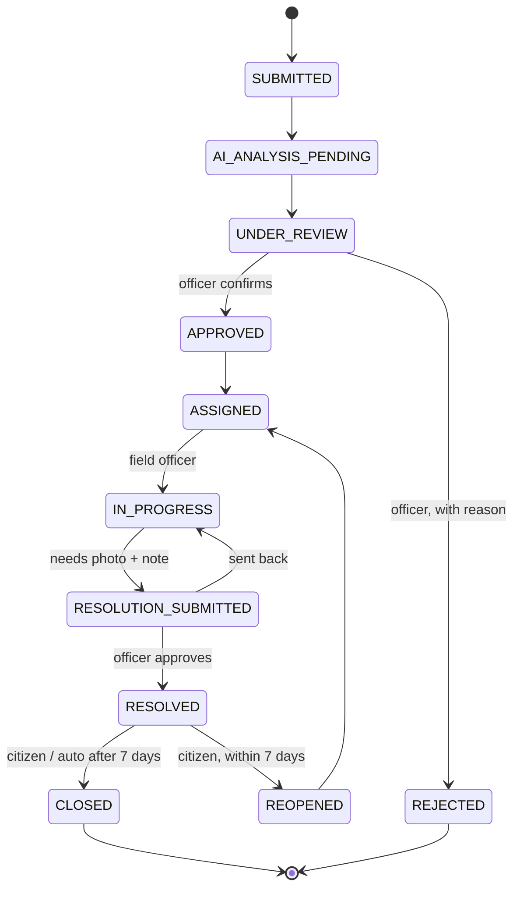
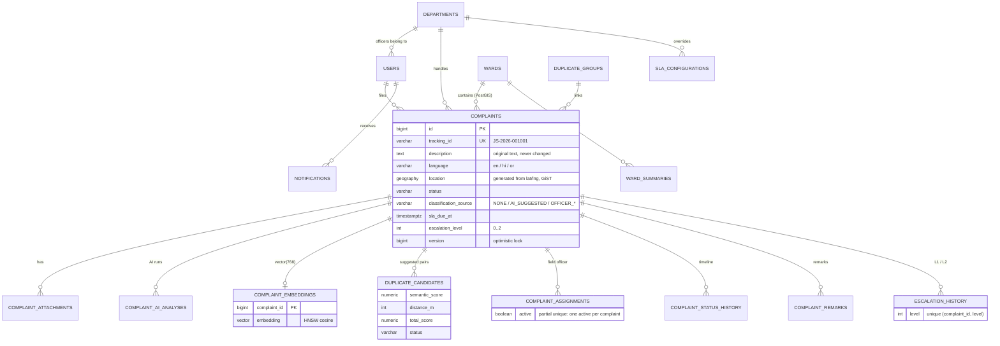

# Architecture

## 1. Blueprint

**Layers.** Controllers only translate HTTP (validation, roles via `@PreAuthorize`). Services own the rules and the
transactions. JPA handles normal entity work; `JdbcTemplate` is used where SQL is clearer or JPA cannot express it
(pgvector `<=>`, PostGIS functions, dashboard aggregates, conditional "exactly once" updates).

## 2. Package map (`com.jansunwai`)

| Package | Responsibility |
|---|---|
| `config` | `AppProperties` (typed config), security, async executor, scheduling, OpenAPI |
| `security` | JWT issue/parse, filter, token revocation, rate limiting, `AccessPolicy` (who may see/act) |
| `entity` | JPA entities + enums; `ComplaintStatus` is the state machine |
| `repository` | Spring Data repositories + JDBC repositories (`EmbeddingRepository`, `GeoRepository`, `DashboardRepository`, `ComplaintSqlRepository`) |
| `ai` | `AiProvider` interface, mock + Spring AI implementations, `AiGateway`, `AiOutputValidator`, `PiiRedactor`, `LanguageDetector` |
| `service` | Complaint, workflow, assignment, attachments, remarks, AI pipeline, duplicates, SLA/escalation, dashboard, ward summaries, users |
| `scheduler` | `SlaMonitorJob` (5 min), `AiRetryJob` (2 min), `WeeklySummaryJob` (Mon 06:10 IST), `TokenCleanupJob` |
| `controller` | REST endpoints |
| `exception` | `ApiError` format + `GlobalExceptionHandler` (400/401/403/404/409/413/415/422) |

## 3. Main flows

### 3.1 Submitting a complaint (AI never blocks the citizen)

Why: an AI call can take seconds. Holding a DB transaction (and connection) during that time would exhaust the pool,
so the slow call happens **between** two short transactions (`TransactionTemplate`). If the AI fails, the complaint is
already safe; `AiRetryJob` retries up to 3 times, then sends it to manual review.

### 3.2 Workflow (state machine)

- *Which* moves exist: `ComplaintStatus.allowedNext()`. *Who* may make them: `WorkflowService` + `AccessPolicy`.
- **Escalation is a flag, not a state** (`escalation_level` 0–2): an overdue complaint stays `IN_PROGRESS` and is also escalated.
- The database repeats key invariants as CHECK constraints (e.g. an APPROVED complaint must have category, department,
  priority and an officer-confirmed classification).

### 3.3 Duplicate detection

1. Embedding of title + English translation is stored in `complaint_embeddings` (`VECTOR(768)`, HNSW cosine index).
2. `findSimilarOlder`: nearest older, open complaints in the last 30 days by `1 - (a <=> b)`.
3. `DuplicateScorer`: `total = 0.60·semantic + 0.25·closeness + 0.15·sameCategory`, closeness = `1 − distance/500 m`
   (a known distance > 500 m disqualifies; unknown location counts as 0.5).
4. Candidates with `semantic ≥ min` and `total ≥ 0.60` are stored as `PENDING` (unique pair → idempotent).
5. An officer approves → the complaints join a `duplicate_group`; the master is worked on, linked complaints follow it
   (accepted together, resolved together). Each citizen keeps their own tracking ID.

### 3.4 SLA monitor (idempotent, safe on several servers)

| Step | Guard that makes it "exactly once" |
|---|---|
| Warning at 75 % of the time | `UPDATE … SET sla_warned_at = now() WHERE id = ? AND sla_warned_at IS NULL` → only the run that updates 1 row notifies |
| Level 1 at the deadline, level 2 after 24 h | `INSERT INTO escalation_history … ON CONFLICT (complaint_id, level) DO NOTHING` → notify only if 1 row inserted |
| Auto-close after 7 days | status check inside the transaction + `@Version` |

Each complaint is handled in its own short transaction, so one failure does not undo the others.
Proven by `EscalationIT.parallelRunsOnSeveralServersStillCreateOneRowPerLevel` (4 threads).

## 4. Data model

Other tables: `audit_logs`, `revoked_tokens` (logout), `ward_summaries` (JSONB facts + narrative).
Schema lives in Flyway migrations: `V1__init_schema.sql`, `V2__reference_data.sql`, demo data in `db/demo/V3__demo_data.sql`
(only loaded by the `dev` profile).

## 5. Key design decisions

| Decision | Why | Alternative considered |
|---|---|---|
| AI behind `AiProvider`, mock by default | Runs offline, free, deterministic tests; swap providers with config | Calling one vendor SDK directly from services |
| AI suggests, humans decide | Wrong routing costs real time; accountability | Auto-routing above a confidence threshold |
| PostgreSQL for vectors and geo | One database, transactions across complaint + vector + location | Separate vector DB (Pinecone) + PostGIS |
| Escalation as a flag | Keeps the true work state; simpler state machine | ESCALATED status |
| Optimistic locking | Conflicts are rare; no lock waits | `SELECT … FOR UPDATE` |
| Sequence for tracking IDs | Unique under concurrency without locks | `max(id)+1` (race condition) |
| Public tracking shows generic notes | Officer notes may contain personal data | Showing full history |
| In-app notifications | Free, testable | SMS/e-mail gateway (paid) |
